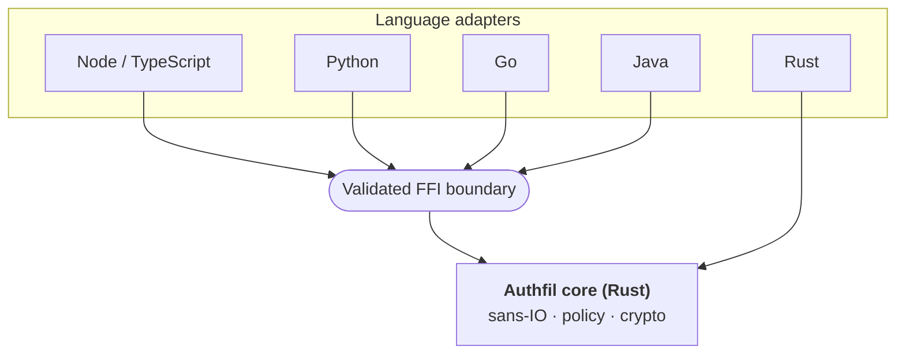

# Auth Fil

**Write the auth once. Use it from every language.**

An open-source authentication, authorization and security library. There's one hardened Rust core, and every programming language gets thin native adapters on top of it.

[Docs](https://authfil.github.io/auth-fil/) · [Core repo](https://github.com/authfil/auth-fil) · [Roadmap](https://github.com/authfil/auth-fil/blob/main/docs/src/content/docs/project/roadmap.md) · [Security](https://github.com/authfil/auth-fil/blob/main/SECURITY.md)

---

## Why Auth Fil exists

In an application, auth is where one small mistake does the most damage. Even so, every language ecosystem builds it again from scratch. Each new version brings its own session fixation bugs, timing leaks, weak token handling and OAuth mistakes.

**Authloom's mission is to be the single source of truth for auth and security across every programming language.** The security logic is written once in Rust and checked against real standards. Node, Python, Go, Java and other languages then use it through their own idioms.

## How it works

- **One core makes every security decision.** It covers password hashing, sessions, tokens, OAuth, MFA and access checks. Adapters only pass data in and out.
- **The core is sans-IO.** It takes in a request, the current time and any stored records, and returns *effects* such as "set this cookie" or "deny". Your app keeps its own database and HTTP stack.
- **One conformance suite covers every adapter.** Each language has to pass the same black-box security tests, so the rules are the same everywhere.
- **Defaults are secure.** The safe option needs no configuration. Any setting that weakens security has to be turned on explicitly, and its name says so.
- **It's measured against standards.** The acceptance criteria come from OWASP ASVS, NIST SP 800-63B and the relevant RFCs.

## What's planned

| | Area | Includes |
|---|---|---|
| 1 | Foundations | Argon2id, secure tokens, constant-time ops, secret handling, key rotation |
| 2 | Sessions & credentials | Email/password, server-side sessions, CSRF, rate limiting, magic links |
| 3 | Federated identity | OAuth 2.0 / OIDC client, PKCE, social providers, safe account linking |
| 4 | Strong authentication | TOTP, recovery codes, passkeys / WebAuthn, step-up auth |
| 5 | Authorization | RBAC, multi-tenancy, ABAC, ReBAC behind one `check()` call |
| 6 | Tokens & API access | JWTs, refresh rotation, API keys, DPoP, device flow, OIDC provider |
| 7 | Enterprise | SAML, SCIM, SSO enforcement, audit logs, GDPR erasure |

> **Status:** early development (Phase 1, Foundations). It isn't ready for production use yet.

## Trust is the product

Threat modelling, fuzzing, supply-chain checks (`cargo-deny`), `#![forbid(unsafe_code)]` in the core and external review are part of the project from the start, not added at the end.

**Found a vulnerability?** Please don't open a public issue. Follow our [security policy](https://github.com/authfil/auth-fil/blob/main/SECURITY.md).

## Get involved

- ⭐ Star [auth-fil](https://github.com/authfil/auth-fil) to follow progress
- 📖 Read the [contributing guide](https://github.com/authfil/auth-fil/blob/main/CONTRIBUTING.md). Security-sensitive changes follow a specific workflow.
- 🌐 Want your language supported? Open an issue to propose an adapter.

MIT licensed · Built in the open

